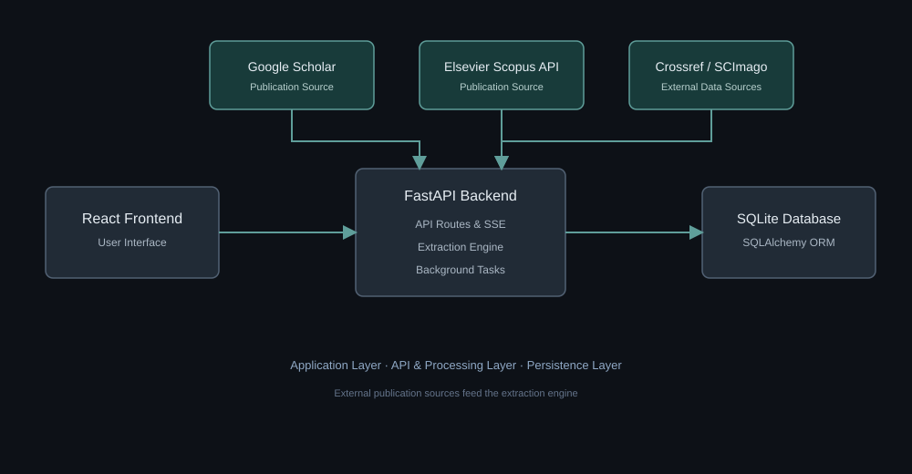
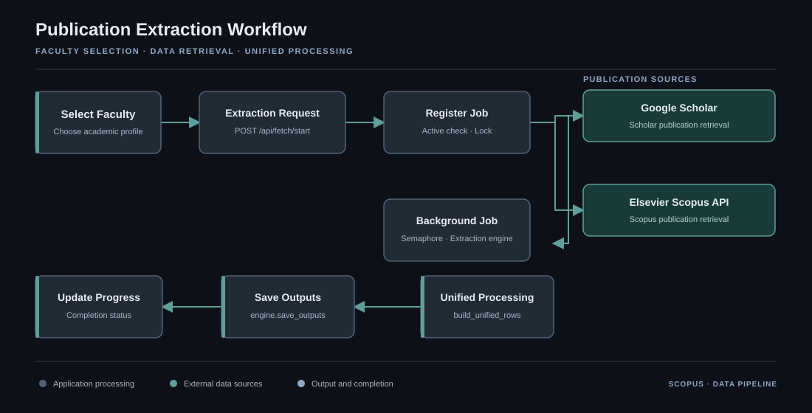
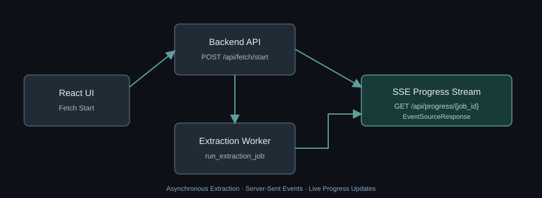
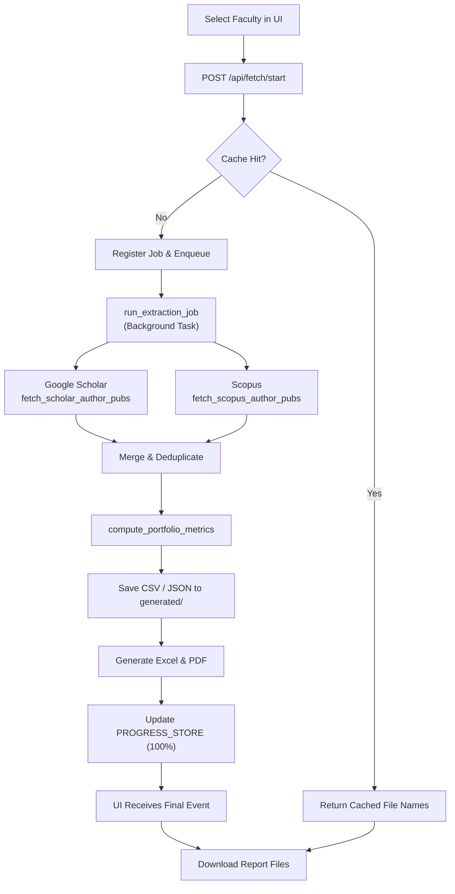

# Scopus – MSRIT Academic Publication Data Aggregator

> **Version:** 2.5.0‑PROD  
> **License:** MIT (see `LICENSE`)

---

## 1. Project Overview
A self‑contained research‑analytics platform that consolidates an author’s scholarly output from **Google Scholar**, **Elsevier Scopus**, and **Crossref/SCImago**. It exposes a **FastAPI** backend for data extraction, real‑time progress via **Server‑Sent Events (SSE)**, and a **React 19** UI for interactive dashboards and on‑demand report generation (CSV, Excel, JSON, PDF).

---

## 2. Key Features
| Feature | Description |
|--------|-------------|
| **Faculty catalogue** | Pre‑populated list of MSRIT faculty with Scopus & Scholar IDs (`00.py`). |
| **Live extraction** | Background job fetches data from external services, streams progress to the UI. |
| **Cache‑first strategy** | Existing reports (`generated/*`) are reused unless `force_refresh` is requested. |
| **Metrics & KPIs** | Automatic calculation of total publications, citations, h‑index, i10‑index, quartile distribution, verified‑record counts. |
| **Export formats** | CSV, JSON, Excel (`xlsx`), PDF (styled report). |
| **Graceful concurrency** | A semaphore limits to a single heavy extraction at a time; job deduplication prevents duplicate work. |
| **Docker‑ready** | Single‑command production deployment (`docker compose up –d`). |
| **Typed API** | Pydantic request/response models guarantee contract stability. |
| **CORS‑secure** | Explicit origins for credentialed requests. |

---

## 3. System Architecture
<p align="center">
  
</p>

The diagram shows the three core components (React UI, FastAPI backend, SQLite DB) and their relationships with external services.

---

## 4. Publication Extraction Workflow


1. **UI** dispatches `POST /api/fetch/start`.  
2. Backend registers the job, checks the cache, and enqueues a background extraction task (`run_extraction_job`).  
3. The extraction task contacts **Google Scholar** (optional) and the **Scopus API**, merges results, computes metrics, writes CSV/JSON, and generates Excel & PDF reports.  
4. Progress events are stored in an in‑memory `PROGRESS_STORE` and emitted via SSE.

---

## 5. Real‑Time Extraction & SSE Workflow


*The UI subscribes to `/api/progress/{job_id}` using `EventSource`. Progress updates flow from the extraction worker → `PROGRESS_STORE` → SSE endpoint → React components.*

---


## 6. Core Application Workflow




---

## 7. Data Sources & Integration
| Source | API / Library | Data retrieved | Optional? |
|--------|--------------|----------------|-----------|
| **Google Scholar** | `scholarly` (Python) | Publication list, citations | Yes – falls back to cached data if unavailable. |
| **Scopus** | Direct HTTP calls (`requests`) using `ELSEVIER_API_KEY` | Author profile, publications, journal metrics | No – required for Scopus‑verified fields. |
| **Crossref / SCImago** | HTTP requests (no authentication) | Journal SJR, quartile information | Yes – used for enrichment only. |
| **Local cache** | Files in `generated/` (CSV/JSON) | Previously generated reports | – |

All external calls are performed inside `backend/services/extractor.py`. The helper `display_progress_bar` is monkey‑patched to push granular SSE updates.

---

## 8. Backend Architecture
### Core modules
| Module | Responsibility |
|--------|----------------|
| `backend/app.py` | FastAPI entry point, CORS config, mounts static React build. |
| `backend/routes.py` | API router (`/api/*`). Handles faculty list, start/fetch requests, progress streaming, downloads, health check. |
| `backend/models.py` | Pydantic request/response schemas (`FetchRequest`, `FetchResponse`, etc.). |
| `backend/services/extractor.py` | Orchestrates the extraction job, progress updates, and interacts with `00.py`. |
| `backend/services/cache.py` | File‑system cache helpers, recent‑report bookkeeping. |
| `backend/services/downloads.py` | Excel and PDF report generation (`reportlab`). |
| `backend/services/utils.py` | Filename sanitisation, KPI calculations, co‑author aggregation. |
| `db.py` + `config.py` | SQLite DB (currently unused beyond session scaffolding). |

### API Endpoints
| Method | Path | Description | Example `curl` |
|--------|------|-------------|---------------|
| `GET` | `/api/faculty` | List all faculty (name, Scopus ID, Scholar ID). | `curl http://localhost:8000/api/faculty` |
| `GET` | `/api/recent` | Last 15 generated reports (metadata only). | `curl http://localhost:8000/api/recent` |
| `POST` | `/api/fetch/start` | Register a new extraction job (or reuse cache). Body: `{ "faculty": "Dr.R China Appala Naidu", "force_refresh": false }` | `curl -X POST -H "Content-Type: application/json" -d '{"faculty":"Dr.R China Appala Naidu"}' http://localhost:8000/api/fetch/start` |
| `GET` | `/api/progress/{job_id}` | SSE stream of progress events. | `curl -N http://localhost:8000/api/progress/Dr_R_China_Appala_Naidu` |
| `POST` | `/api/fetch` | Synchronous extraction (rare, used by internal calls). | `curl -X POST -H "Content-Type: application/json" -d '{"faculty":"Dr.R China Appala Naidu","force_refresh":true}' http://localhost:8000/api/fetch` |
| `GET` | `/api/download/csv/{filename}` | Download CSV report. | `curl -O http://localhost:8000/api/download/csv/Dr_R_China_Appala_Naidu.csv` |
| `GET` | `/api/download/json/{filename}` | Download JSON report. | `curl -O http://localhost:8000/api/download/json/Dr_R_China_Appala_Naidu.json` |
| `GET` | `/api/download/excel/{filename}` | Download Excel (`.xlsx`). | `curl -O http://localhost:8000/api/download/excel/Dr_R_China_Appala_Naidu.xlsx` |
| `GET` | `/api/download/pdf/{filename}` | Download PDF report. | `curl -O http://localhost:8000/api/download/pdf/Dr_R_China_Appala_Naidu.pdf` |
| `GET` | `/api/health` | Liveness / dependency check. | `curl http://localhost:8000/api/health` |

All responses follow the `{ "success": bool, "message": "...", "data": ... }` pattern for errors; successful fetches return the `FetchResponse` model.

---

## 9. Frontend Architecture
*Located under `frontend/`.*

| Directory | Highlights |
|-----------|------------|
| `src/components/` | `PublicationCard.tsx` (row rendering), `DownloadSection.tsx` (file links), `AboutPage.tsx` (static info). |
| `src/pages/` | Dashboard (`HomePage.tsx`) drives the extraction flow, consumes SSE, displays KPIs and publication tables. |
| `src/api/` | Thin wrapper around `fetch` for the FastAPI routes. |
| `tailwind.config.js` | Utility‑first styling; colour palette matches the SVG theme (charcoal, slate, muted blue/teal). |
| `vite.config.ts` | Development server on port 5173 (CORS origins configured in backend). |
| `public/` | `index.html` – entry point for production build (`frontend/dist`). |

The UI:
* Lets the user pick a faculty name from a dropdown.
* Starts extraction via `/api/fetch/start`.
* Subscribes to `/api/progress/{job_id}` using `EventSource`.
* Shows a progress bar, then presents download buttons for all generated assets.

---

## 10. Database Design
The app uses **SQLite** (`scholar.db`) via SQLAlchemy for future extensions, but the current release stores all artefacts on disk (`generated/`). No tables are defined yet; `db.py` merely creates the engine and a session factory.

*If needed, the `Base` model can be expanded to persist author‑level metrics, job logs, or user preferences.*

---

## 11. Export & Reporting Workflow
1. **CSV / JSON** – `engine.save_outputs(author_name, rows)` writes both files under `generated/{csv,json}`.  
2. **Excel** – `generate_excel_report` creates a simple sheet with all rows (`pandas` + `openpyxl`).  
3. **PDF** – `generate_pdf_report` builds a styled landscape PDF (ReportLab) that includes:
   * University header
   * Author profile table
   * KPI summary
   * Quartile distribution
   * Top‑40 publications table (title, year, venue, citations, verification)

All files are made available through the `/api/download/*` endpoints.

---

## 12. Technology Stack
| Layer | Tool | Version (as of repository) |
|------|------|-----------------------------|
| **Backend** | FastAPI | 0.138.2 |
| | Uvicorn | 0.49.0 |
| | SQLAlchemy | 2.x (via `config.py`) |
| | Requests | 2.34.2 |
| | Scholarly | 1.7.11 |
| | Pandas / Openpyxl | 3.0.3 / 3.1.5 |
| | ReportLab | 5.0.0 |
| **Frontend** | React 19 | (via Vite) |
| | Vite | 5.x |
| | TypeScript | 5.x |
| | Tailwind CSS | 3.x |
| | Lucide‑react icons | – |
| **DevOps** | Docker | 27.x |
| | Docker Compose | 2.x |
| **Testing / Linting** | pytest (optional) | – |
| **Docs** | Mermaid (inline) | – |

---

## 13. Project Structure
```
├── backend
│   ├── app.py                 # FastAPI entry point
│   ├── routes.py              # API router
│   ├── models.py              # Pydantic schemas
│   ├── services
│   │   ├── extractor.py       # Core extraction logic
│   │   ├── cache.py           # File cache helpers
│   │   ├── downloads.py       # Excel / PDF generation
│   │   └── utils.py           # KPI & filename utilities
│   └── __init__.py
├── frontend
│   ├── src
│   │   ├── components        # UI widgets (PublicationCard, DownloadSection, …)
│   │   ├── pages
│   │   └── api.ts
│   ├── public
│   ├── vite.config.ts
│   └── tailwind.config.js
├── generated
│   ├── csv   # cached CSV reports
│   ├── json  # cached JSON reports
│   ├── excel # cached XLSX reports
│   └── pdf   # cached PDF reports
├── docs
│   └── images
│       ├── system_architecture.svg
│       ├── extraction_workflow.svg
│       └── sse_workflow.svg
├── 00.py                        # Extraction engine & faculty list
├── Dockerfile
├── docker‑compose.yml
├── requirements.txt             # Backend deps
├── package.json                 # Frontend deps
├── .env.example                 # Sample env (ELSEVIER_API_KEY, SCHOLARLY_USE_PROXY)
└── README.md                    # ← this file
```

---

## 14. Prerequisites
| Item | Minimum version |
|------|-----------------|
| Python | 3.12 |
| Node.js | 20.x |
| Docker | 27.x (optional, for production) |
| Environment variables | `ELSEVIER_API_KEY` (Scopus), optional `SCHOLARLY_USE_PROXY` |

---

## 15. Local Installation
```bash
# 1️⃣ Clone the repo (already done)
cd /Users/armank.b/Desktop/everything/scopus

# 2️⃣ Backend
python3 -m venv venv
source venv/bin/activate
pip install -r requirements.txt

# 3️⃣ Frontend
cd frontend
npm ci            # installs exact versions from package-lock.json
npm run dev       # starts Vite dev server on http://localhost:5173

# 4️⃣ Run the API
cd ../backend
uvicorn backend.app:app --host 0.0.0.0 --port 8000 --reload
```
The UI will proxy API requests to `http://localhost:8000`. CORS origins are pre‑configured in `backend/app.py`.

---

## 16. Docker Deployment
```bash
# Build & start both services
docker compose up -d --build

# API: http://localhost:8000
# UI: http://localhost:5173 (Vite preview) or http://localhost:80 (served static assets)
```
*The `Dockerfile` builds the React app, copies the static files into the FastAPI container, and serves them via `StaticFiles` when `frontend/dist` exists.*

---

## 17. API Documentation
FastAPI automatically generates Swagger UI at `http://localhost:8000/docs` and ReDoc at `http://localhost:8000/redoc`. The definitions reflect the Pydantic models in `backend/models.py`.

---

## 18. Troubleshooting
| Symptom | Likely cause | Fix |
|---------|--------------|-----|
| **404 on `/api/download/*`** | Report files not generated / cache miss | Ensure extraction completed (`progress` reaches 100 %). |
| **`scholarly` import fails** | Missing optional dependency or network block | Install `scholarly` (`pip install scholarly`) and verify internet connectivity. |
| **Scopus API returns 401** | Invalid or missing `ELSEVIER_API_KEY` | Populate `.env` with a valid key (or set the env var directly). |
| **CORS error** | Frontend origin not listed in `ALLOWED_ORIGINS` | Add the dev URL (e.g., `http://localhost:5173`) to `backend/app.py`. |
| **Docker container exits** | Port conflict or missing env vars | Use `docker compose logs` to inspect; map ports or supply `environment:` entries. |

---

## 19. Limitations & Future Improvements
* **Database persistence** – Current cache relies on filesystem; a real relational schema could enable multi‑user queries.  
* **Authentication** – Public API; adding token‑based auth would protect quota‑limited external services.  
* **Scalability** – Extraction is deliberately single‑threaded; a distributed job queue (e.g., Celery + Redis) would allow parallel processing of many faculty members.  
* **Testing** – Unit tests for the extraction pipeline are minimal; expanding coverage would reduce regression risk.  
* **UI polish** – The React UI is functional but could benefit from more visual analytics (charts, pagination).

---

## 20. License
MIT License – see `LICENSE`.
